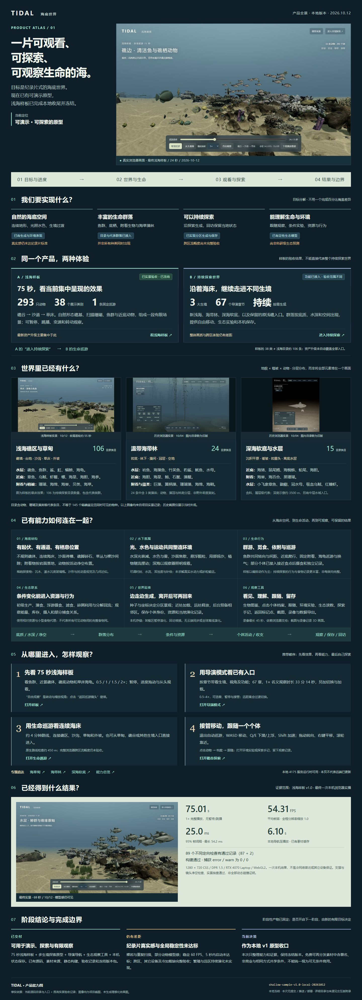

> **阶段02 · 本地浅海整合已验收归档：** [进入4分钟完整浅海体验](http://127.0.0.1:4175/ocean-world/?demo=shallow-journey&seed=55)。现有资产、六段同景巡游、可接管探索；新增[中文语音讲解、同步字幕与音量控制](docs/stages/STAGE_02_NARRATION.md)（本地版本）；[范围与验收](docs/stages/STAGE_02_SHALLOW_JOURNEY.md)。已完整实播240秒，无途中加载，首次进入约8.51秒；此次不部署远端，以下原引导图保留。

# TIDAL · 海底世界

> **阶段01已整理为可演示原型，主线回到海底世界建设与阶段归档。** 已有75秒样板、多生境探索、动物群落与观察工具；真实感和性能差距作为阶段限制保留。最近的性能实验未达标，已经停止，本次不部署。[阶段成果、版本与后续推进方式](docs/stages/STAGE_01_OCEAN_PROTOTYPE.md)。

一个可以观看、探索和观察生命的浏览器海底原型。目标是自然光照、真实比例、丰富生境与安静观察的海洋纪录片式体验；当前交付是**冻结的 75 秒浅海样板 + 持续探索世界 + 生态观察工具**。

[产品导览与所有入口](https://yydshly.github.io/ocean-world/overview/) · [75 秒浅海样板](https://yydshly.github.io/ocean-world/?demo=shallow-sample&seed=55) · [生命巡游](https://yydshly.github.io/ocean-world/?demo=life-expedition&seed=55&world=whole-seabed) · [导演模式](https://yydshly.github.io/ocean-world/?demo=director&seed=55)

[](https://yydshly.github.io/ocean-world/overview/)

**一张图了解产品。** 原版引导图直接展示在根目录 README，点击图片进入交互导览，查看完整生物目录、67 个导演章节与 15 个专题入口。[下载原版长图](https://yydshly.github.io/ocean-world/overview/ocean-world-product-atlas.png)。

图像来自项目实景记录，保留 2026-10-12 本地汇总时的历史状态文字；冻结版本已上线，当前状态以本文与 [发布工作流](https://github.com/yydshly/ocean-world/actions/workflows/pages.yml) 为准。海带林、深海截图注明了历史日期，不能用来证明当前目录中的所有生物已同屏呈现。

## 我们对产品的共同理解

我们要构建一片能让人安静观察、逐步探索并理解生命活动的海。长期方向是海洋纪录片式真实感；当前阶段交付可体验、可验证的原型。

- **先形成整体海底空间。** 礁坡、沙道、草床、光照层次和动物栖息空间应连贯，先验证完整镜头与巡游效果，再决定是否需要细节改进。
- **动物群落是核心。** 让水层鱼群、大型巡游动物、近底动物和附着生物有清楚的活动层次；丰富度要体现在观察体验和行为上。
- **分布遵循生境条件。** 用水深、光照、底质、水流和活动净空约束出现位置。海草扎根沉积物、海带以固着器附着岩底；这些自然规律是设计依据，现有模型仍是有限近似。
- **探索持续，回访有记忆。** 按种子和坐标沿探索生成区域，保存当地个体和资源状态；当前卸载区域暂停演化，尚无全球离线演化。
- **用明确验收结束每个阶段。** 先确定范围、可见效果和性能标准，在本地验证后阶段性提交发布；当前版本保持冻结，下一阶段需另行确定有限目标。
- **保留素材来源与条件。** 只使用自制或免费且允许按条件再分发的素材，遵守署名、非商业和相同方式共享要求。

> 当前能力基线：`shallow-sample-v1.0-local-20261012`。已发布 **75 秒浅海样板 + 持续探索世界 + 生态观察工具 + 产品导览**，仍未达到纪录片真实感或全设备稳定性能。上一冻结成果发布的 [1,509 项云端检查全部通过](https://github.com/yydshly/ocean-world/actions/runs/38203501128)，线上导览、图片、样板启动和返回导航已实测；这不等于所有入口都完成了完整浏览器巡游验收。

## 先从哪里看

| 入口 | 用途 | 观看方式与范围 |
| --- | --- | --- |
| [产品导览](https://yydshly.github.io/ocean-world/overview/) | 首次了解产品 | 目标、能力图、实景模块、目录、全部主要入口与验证证据 |
| [75 秒浅海样板](https://yydshly.github.io/ocean-world/?demo=shallow-sample&seed=55) | 看集中呈现的浅海效果 | 礁谷 → 沙道 → 草床；293 个体、38 个展示类别；已完成一次最终本机完整实播 |
| [导演模式](https://yydshly.github.io/ocean-world/?demo=director&seed=55) | 自动带看已有入口 | 67 章；1× 名义观察时长 33 分 14 秒，加载与转场另计；可选章与接管 |
| [生命巡游](https://yydshly.github.io/ocean-world/?demo=life-expedition&seed=55&world=whole-seabed) | 看连续海床与生境衔接 | 240 秒、约 452 米；本轮按完整浏览器实播记录验收，区域准备期间会等待 |
| [礁谷探索](https://yydshly.github.io/ocean-world/?demo=reef-valley-region&seed=55&world=whole-seabed) / [海草甸](https://yydshly.github.io/ocean-world/?demo=seagrass-meadow-region&seed=55&world=whole-seabed) | 自由走进浅海 | 按底质、水深和保存状态生成与延续群落 |
| [海带林](https://yydshly.github.io/ocean-world/?demo=kelp-life&seed=55) / [深海软底](https://yydshly.github.io/ocean-world/?demo=deep-life&seed=55) | 看不同生境 | 藻林分层生活、沉积海床与观察器照明 |

**样板和持续探索是两种体验。** 最新近景资产升级主要集中在样板；它的画面、293 个体、38 类及 75 秒性能结果不能外推到整个探索世界。导演模式负责既有功能入口，75 秒样板是独立入口。

## 已实现的能力

| 方向 | 当前可体验内容 | 边界 |
| --- | --- | --- |
| 地形与景物 | 连续海床、不规则礁体、沙脊、礁脚碎石、草床与裸沙间隙；少量沉木和灌水沉底玻璃瓶 | 不是完整地质、水动力或砂粒输运模拟 |
| 水下环境 | 深度光衰减、雾与水色、焦散、悬浮颗粒、局部扬沙、植物随流摆动、深海观察灯 | 视觉与物理规则均为有限近似 |
| 动物与植被 | 水层鱼群、大型巡游动物、底栖动物、固定附着生物、珊瑚、海草及藻林 | 生物按生境出现，不是全部条目同时出生；形态与风格仍不统一 |
| 生命与生态 | 群游、爬行、附着、海龟换气；部分接触摄食、能量与资源收支、碎屑分解及捕食联系 | 样板主要采用编排动作；探索世界使用相对食物代理，繁殖与完整食物网未实现 |
| 持续探索 | 种子和坐标决定按需生成的区域，近区加载与远区释放、相邻区后台准备 | 无预设水平场景墙，不代表有限设备能同时运行无限海域 |
| 回访与保存 | 个体身份、当地资源与演化状态保存到本机；探索手记、标记位置和返回 | 卸载区暂停演化；无云同步和全球离线演化，浏览器存储被清除后可能丢失 |
| 观察与导出 | 预设视角、点击档案、跟随、生物图鉴、环境实验、生态读数、截图、录像、数据导出 | 录像最长 45 秒且依赖浏览器支持；录像和截图仅含 3D 画面 |

### 生境与生物目录

| 生境 | 当前目录条目 | 已接入的代表内容 |
| --- | ---: | --- |
| 浅海礁区与草甸 | 106 | 礁鱼与鱼群、鲨魟与海龟、头足类、虾蟹螺、棘皮动物、珊瑚、海绵、贝类等 |
| 温带海带林 | 24 | 岩鱼、海藻鱼、豹鲨、鱿鱼、水母、海胆、海星、鲍、石鳖与 3 类藻体等 |
| 深海软底与水层 | 15 | 海猪、鼠尾鳕、海蜘蛛、海葵、蛇尾、海百合、黑珊瑚与中层游泳动物等 |

目录包含具名物种、科/属代表及藻类等不同层级，不等于 145 个精确鉴定的物种，也不等于同屏可见数量。完整清单见 [导览附录](https://yydshly.github.io/ocean-world/overview/#appendix) 或 [结构化清单](public/overview/inventory.json)。

## 如何观察和探索

1. **观看样板**：选择 0.5 / 1 / 1.5 / 2×；可暂停、拖动 0–75 秒进度或从头播放。“自由观察”可拖动旋转与滚轮靠近，点击“返回巡游镜头”继续。
2. **导演带看**：支持 0.5 / 1 / 1.5 / 2 / 4×、章节选择、暂停与手动接管；远距离入口通过转场切换，并非所有生境之间连续游过去。
3. **自由移动**：在持续探索中退出自动巡游，`W A S D` 移动，`Q / E` 下潜/上浮，`Shift` 加速；拖动转向、右键平移、滚轮靠近。
4. **看一个个体**：点击生物查看档案、尺寸、状态与可用的摄食记录，选择“跟随观察”；拖动视角可退出跟随。
5. **做一次有限实验**：在“环境实验”改变水流、浑浊、补给或观察时刻，对照当地资源与行为。深海观察灯只改善可见性，不提供生态能量。
6. **留下记录**：通过“探索手记”标记位置、返回观察点；导出截图、录像或当前实验数据。线上文件由浏览器下载，注意实际下载结果。

## 验证结果与已知差距

上一发布版已接入三项体验改进：导演跨区时遇到当前种子不存在的整景观察点，会明确提示并观察同海域已有生境；生命巡游的生态积分与历史区域完整校验移到后台线程，保存和换区前等待已提交的计算；浅海样板的大体积模型数据拆成可独立缓存的压缩文件，主样板 JavaScript 从约 17.1 MB 降至 2.54 MB。几何、原图、293 个体和 38 个展示类别保持同一冻结基线。

上一发布版的播放、长帧和定向检查见[入口体验验收记录](public/overview/evidence/entry-experience.json)；最新未发布候选见[跨区准备流水线验收](docs/TRANSITION_PIPELINE.md)；此前记录保留在[历史准备](docs/HISTORY_PREPARATION.md)、[稳定演示](docs/STABLE_DEMO.md)、[回访验收](docs/DIRECTOR_CROSSING.md)及[入口验收](docs/STABLE_EXPERIENCE.md)。从上方引导图进入导览后，建议先看 75 秒样板，再进入生命巡游；导演模式可以选章、变速或退出观察。首次区域准备仍需等待，67 章全程与所有设备的稳定帧率不由单次定向检查保证。

原冻结v1.0的最终本机样板记录：1× 完整播放 **75.0137 秒**，无暂停、跳播或后台中断；1280×720 CSS、DPR 1.5、RTX 4070 Laptop、WebGL2，全程分辨率缩放 1.0。最新本地候选的结果见上方验收，不替换此历史记录。

| 指标 | 实测 |
| --- | ---: |
| 平均 rAF 帧率 | 54.31 FPS |
| 95% 帧间隔 / 最长帧间隔 | 25.0 ms / 54.2 ms |
| 超过 50 ms 的帧 | 1 |
| 导航至播放 / 应用初始化 | 6.10 s / 5.28 s |
| 捕获 error / warn | 0 / 0 |

89 个不同定向检查有通过记录（87 项主检查 + 2 项资源准备检查）。这些是**冻结时的本机记录**，不是本次云端测试数量；本轮构建与发布检查以 Actions 日志为准。

- 当前仍未达成：纪录片真实感、稳定 60 FPS、5 秒内启动；扫描重复、局部裸岩与部分动物模型感依旧存在。
- 以上加载时间来自已有素材缓存的本地访问，不是公网冷首访或其它设备保证；持续探索跨区等待仍需单独评估。
- 支撑、活动范围和镜头净空检查及实景抽查通过，不等于所有动物之间的连续动态碰撞证明。
- 生态数量、密度、代谢与食物关系未做科研级校准；未实现完整繁殖、全球迁徙与卸载区域持续演化。

[冻结阶段说明](docs/SHALLOW_SAMPLE_FROZEN.md) · [实景验收与原始数据](https://yydshly.github.io/ocean-world/overview/evidence/review.html) · [当前状态](docs/CURRENT_STATUS.md)

## 本地运行

需要 Node.js 22 与 npm；当前构建基于 React、Vite 和 Three.js。

```bash
npm ci
npm run build:local
npm run preview:local
```

打开：

- 产品导览：`http://127.0.0.1:4175/ocean-world/overview/`
- 浅海样板：`http://127.0.0.1:4175/ocean-world/?demo=shallow-sample&seed=55`

`build:local` 与 `preview:local` 固定配套 `/ocean-world/` 基路径。开发可运行 `npm run dev`，使用终端实际显示的地址；预览服务不负责自动构建。只有导览静态文件时，也可直接打开 `public/overview/index.html` 阅读，3D 体验仍需运行服务。

```bash
npm run build:overview  # 更新可部署导览 HTML 和目录，不修改原版引导 PNG
npm run test:publication # 检查导览链接、资源、目录数量和构建基路径
```

完整浅海回归运行 `npm run test:shallow`。其中原生贴图检查还需要 Python 3.10：先运行 `python -m pip install -r requirements-test.txt`；可用 `SHALLOW_PYTHON` 指定 Python 路径。CI 会自动安装这些测试依赖，网页运行与普通构建无需 Python。

## 部署与目录

GitHub Pages 使用 `.github/workflows/pages.yml`：依赖安装 → 按仓库基路径构建 → 功能及发布检查 → 上传静态文件 → 发布。推送 `main` 会触发；部署要求仓库变量 `PAGES_ENABLED=true` 和 Pages 的 Actions 发布设置。静态产物是 `dist/client/`。 原有 237 个世界检查文件全部保留：236 个分为 8 个并行组，1 个依赖构建产物的检查随构建执行；浅海样板和导览另有独立检查。所有组通过后才部署。

| 路径 | 内容 |
| --- | --- |
| `src/ShallowSampleApp.jsx`、`src/shallowSample*` | 冻结浅海样板与播放 |
| `src/OceanApp.jsx`、`src/ocean*`、`src/world/` | 持续探索、动物、生态与渲染 |
| `src/sceneCatalog.js`、`src/demoCapabilities.js`、`src/directorTour.js` | 生物目录、入口与导演章节 |
| `public/overview/` | 正式产品导览、原版引导图、实景图与精选验收证据 |
| `public/assets/` | 运行素材、署名与来源清单 |
| `tests/` | 功能、几何、生态、加载及发布验证 |
| `docs/` | 当前状态、阶段记录与历史归档 |
| `output/` | 本机原始验证与冻结归档；多数不入库，不作为构建必需输入 |

## 素材、署名与使用范围

模型与纹理由项目自制或使用免费且允许按条件再分发的来源。第三方素材包括 **CC0、CC BY、CC BY-NC、CC BY-NC-SA**；保留作者、来源、改动说明与原有条件。**免费不等于无限制商用**，尤其非商业及相同方式共享素材需要按各自许可处理。本仓库未将所有内容统一授权为 MIT 或其它宽松许可证。

完整 [模型来源与署名](https://yydshly.github.io/ocean-world/assets/shallow-artist/credits.html)；各包 `public/assets/*/provenance.json` 保留具体作者、来源、许可和修改记录。引导图是这些场景的真实截图，也应保留相应来源和使用条件。

## 阶段管理

本版将已完成的开发成果与产品导览一起发布，随后保持功能冻结。只有明确的新目标、范围和验收标准才开启后续开发；已知画质差距不自动触发继续迭代。

早期逐批更新保存在 [README 历史归档](docs/history/README-before-product-release.md) 和 [状态历史归档](docs/history/CURRENT_STATUS-before-product-release.md)。历史记录中的“未部署”“下一步”描述的是当时状态，以本 README、当前状态页及实际 Actions 发布结果为准。
