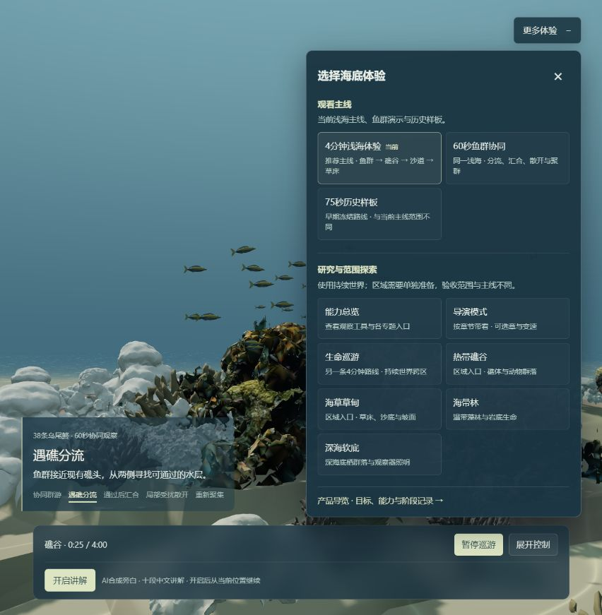

# 入口导航与区域准备：有限收尾

2026-10-13，接续阶段05发布后的入口检查。范围只包括让已实现的体验可被找到、修正区域进入时的等待状态，并核验发布；不新增物种、资产、路线或生态规则。

## 本次变化

- 浅海专注观看、初次下载、场景构建及加载错误界面常驻“更多体验”。菜单按“观看主线”和“研究与范围探索”区分10个主要入口，保留种子，重新构造目的地参数。
- 当前主线是4分钟浅海及其60秒鱼群协同开场；75秒为历史观看样板。研究入口包括能力总览、导演、生命巡游、礁谷、草甸、海带林和深海。
- 研究页面提供“返回4分钟浅海主线”，加载期间也可返回。正式导览、README与页面菜单使用一致的入口地址。
- 修正导演旧“约8分钟”文案。现有67章是较长流程；原名义观察时长33分14秒，准备和转场另计。
- 礁谷、草甸原生异步入口保留准备状态，避免快照更新引起重复进入。Promise完成后用新鲜快照核对当前格及相邻八格的实际地形和生态；合法空群落也算就绪。取消后旧入口不能确认或覆盖新选择。

## 对上轮诊断的更正

上轮远端礁谷抽样时，相机已在204,5，生态仍是206–208列的旧九格，加载计数为0。这个快照不能证明目的地完成，也不足以证明永久失败。

本轮在修改运行代码前完整等待旧版本的本地入口：第二窗口最终完成，204,5及邻格地形、生态齐全，本格17个活体、13类，错误为空。确认的问题是UI过早清除等待；没有根据一个未完成快照猜测修改生态队列。

真实seed55测试暂停第二窗口：旧窗口九格、加载计数0仍拒绝确认；释放后新九格地形及生态齐备才完成。原历史、保存、物理门槛和渐进地形加载范围保持。

## 本地验证

以下是发布前本地结果；远端结果另列，不把两种验证混用。

- 166项浅海检查、51项入口与导航检查、10项发布与托管检查通过。
- 两项真实区域定向检查通过，包括第二窗口阻塞/恢复；其余原世界回归由发布工作流执行。
- 最终本地构建通过，Vite17.54秒。143份路线、音频及资产文件哈希保持，未修改生成/历史校验队列。
- 4分钟主线完整1×实播240.0084实秒，无操作中断；1280×720、DPR1.5、RTX4070 Laptop，画质倍率1，p95帧间隔16.7ms、最长100ms，没有超过250ms的帧间隔，控制台错误/警告为空。
- 本地主线初始化8.158秒，常规缓存未清，不是冷启动或5秒达标。本轮不宣称缩短历史校验或首次资源下载。
- 390×844菜单无水平溢出；这是桌面浏览器布局检查，不是手机性能验收。

## 范围边界

本次不代表海底世界完全完成。4分钟主线与60秒演示仍是有限编排体验；旧研究页面的视觉、跨区等待和帧率不能套用主线结论。没有完整重播全部67章、所有跨区路线或手机实机；未进行新的独立语音试听。

原模型感、扫描硬边、固定场景、240秒后鱼群保持末帧及未加载区域生态冻结等限制继续保留。本轮验证后归档，不开启下一轮自动优化。

## 发布检查记录

首次工作流38408452230构建与七组世界检查通过，第1组180项通过、7项失败，部署跳过。七项导演切换检查共用的旧测试记录没有提供`ocean.streaming.loadedChunks`，严格九格条件因此正确拒绝退出遮罩。保留失败日志，不把推送等同上线。

仅补齐测试中的地形窗口，生态与地形缺格仍独立拒绝；新增缺地形保持遮罩检查。导演切换、就绪及原生等待三组29项全部通过。没有修改运行代码、扩大超时、跳过校验或新增优化。

## 实际远端结果与归档

发布提交`5e4c280b2cd4dc237a9375b69ea9c843c65fd979`的[工作流38411166224](https://github.com/yydshly/ocean-world/actions/runs/38411166224)构建、8组世界检查及部署共10个任务全部成功。该提交只修正测试和回执，运行内容与`b575739`相同；143份冻结文件独立核验全部匹配。

- 初次加载界面及浅海画面都能打开“更多体验”；10个真实目的地地址、正式导览分组及研究返回主线已实测。
- 4分钟主线完整1×播放240.0191实秒，无操作中断，p95帧间隔12.5ms、最长62.5ms、超过250ms为0；控制台错误和警告为空。
- 60秒协同完整1×播放60.0081实秒，无操作中断，p95为12.5ms、最长54.2ms、超过250ms为0；控制台为空。两条完整播放均未开启讲解，不作为新的语音试听验收。
- 远端主线起始和末次实际视口约853×871、DPR1.5、画质倍率1，RTX4070 Laptop；其他既有页面仍打开，不是隔离单页或受控前后对比。
- 礁谷204,5及草甸228,5的当前格与邻八格地形和生态均齐备，本格17个活体/13类、14个活体/9类。已点击研究返回链接，回到正确的4分钟页面。
- 导演首章两次快照中镜头位置、进度持续变化，末次约68.93模型秒；生命巡游从37.79秒/71.24米到82.12秒/154.80米，无当次错误。仅为启动与短段检查，不是完整800秒首章、全部67章或完整生命路线验收。
- 能力总览与深海专题能打开；75秒历史样板检查到34.82模型秒，导航到播放10.16秒，不是新的完整75秒验收。

**未通过与保留项：** 本次新部署主线导航到播放70.597秒，初始化8.717秒，初始准备贴图只记录1/47；60秒缓存入口6.797秒、初始化5.648秒、47/47。正常缓存未清，未达5秒加载目标，首轮材质完整性没有独立通过验收。下载、解析及构建中各项占比尚未在本轮精确定位，不因完整播放顺畅而隐去加载差距。

海带林界面能进入，但当前浏览器既有存档恢复失败，实际提示`Invalid saved kelp water-life community; original animals and inventory were not regenerated.`。诊断错误数组和控制台为空仍不能覆盖这条可见失败。原记录保持，没有清空存档或重新生成动物来制造通过结果；此入口本次不能判为正常体验。

[结构化结果](../validation/entry-navigation-20261013.json)保留完整主线、短段抽查、首次工作流失败及已知问题；本地原始日志和播放记录位于`output/validation/entry-navigation-closeout/`。归档标签`stage-05-entry-navigation-published-20261013`只标记本次有限导航发布，不代表海底世界最终完成。

此轮到此收口，不扩大场景、资产或自动修补旧存档。后续若继续，宜另定有限目标处理首次加载及海带林存档兼容性；原视觉和生态边界保持。
