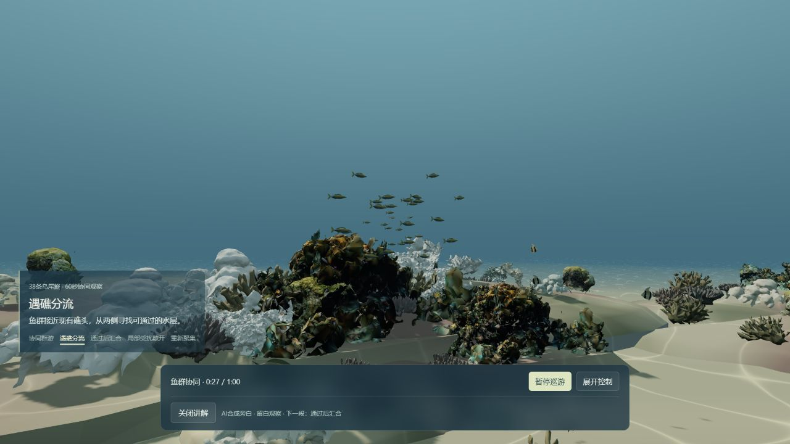
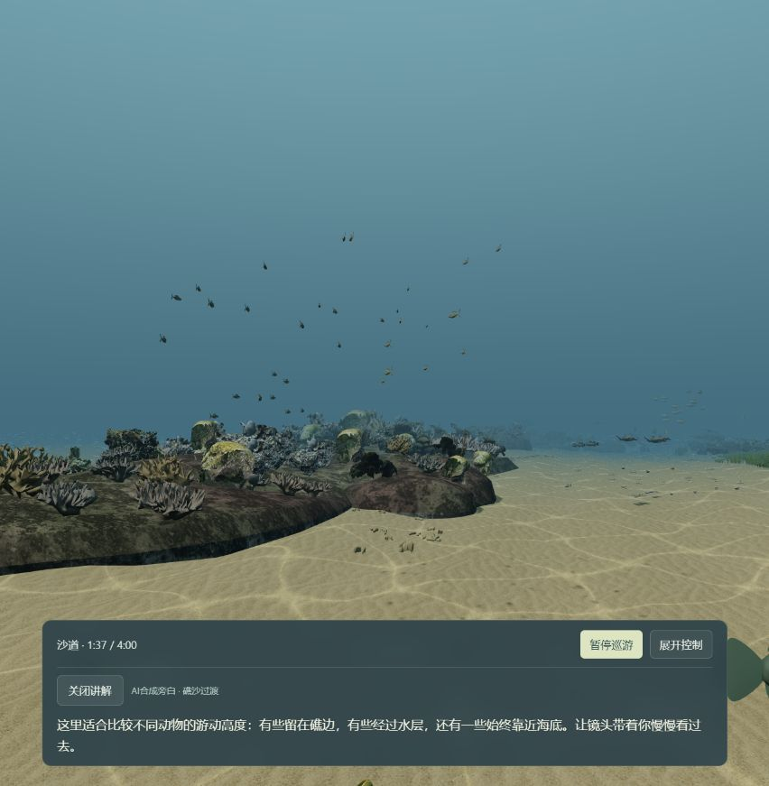

# 阶段05：鱼群协同与中文观察讲解

2026-10-13，用户授权发布已本地归档的鱼群协同演示，更新正式导览，并增加适当讲解。范围限于发布、五段短旁白及实际播放核验，完成后归档；不继续优化场景、动物或加载流程。

## 发布内容

- 沿用38条乌尾鮗、293个动物和原4分钟路线。60秒窗口展示协同群游、遇礁分流、汇合、受扰散开和重新聚集。
- 五段MiniMax中文合成旁白与同步字幕，共24.336秒、397,956字节；起始为0、8、28、36、46秒，各段之间留出安静观察时间。
- 60秒入口使用五段新旁白。4分钟入口前60秒使用同一讲解，随后沿用五段已有栖息地旁白，礁边讲解移到64秒，避免覆盖鱼群恢复阶段；原六段录音文件保持。
- 手动开启讲解，保留音量、字幕、重听、暂停、倍速、跳段及探索返回同步。浏览器不允许播放时可显式重试。
- README原引导图保持，正式导览新增60秒入口及阶段05四段实景页，4分钟仍为完整浅海主线。

## 发布与核验状态

已于2026-10-13部署GitHub Pages：运行提交 **`e5733473d226d4c3cf6a0d553fbdafb0c0716ef9`**，归档标签 **`stage-05-schooling-published-20261013`**。[工作流38394640991](https://github.com/yydshly/ocean-world/actions/runs/38394640991)的build、8组世界回归与deploy共10个job全部成功。同一发布内容的13个冻结运行文件保持一致；初轮26项中23项导览、图像、音频与样式直接字节一致，3项生成引用差异保留原证据。线上实际HTML和两份脚本均200；脚本仅资源哈希引用不同，HTML另有同一预载集合的顺序差异，规范这些引用后完整内容一致。11份模型仅gzip头OS字段不同，解压数据一致；另1份静态几何包原字节一致。失败的Actions产物下载未重试，也未当作产物比对成功。

已部署、完成两条1倍速连续实播并阶段性归档；真实感、加载和有限协同等既有边界继续保留。

本轮本机166项浅海、6项发布与4项托管检查通过，共176项不同相关检查；26项讲解定向检查包含在166项内，不重复累加。Vite构建17.62秒；不是重新本地运行完整世界套件。新配音60秒本地实播59.9943实秒，1×完整、无操作中断，p95 12.6ms、最长50.0ms，导航6.827秒、47/47张贴图。旧a935a3e的60/240记录及六段旧旁白保留为先前本地归档，不替代此次配音和远端验证。

| 项目 | 60秒鱼群协同 | 4分钟浅海体验 |
| --- | --- | --- |
| 实际连续播放 | 60模型秒 / 59.9985实秒 / 1× / 无操作中断 | 240模型秒 / 240.0559实秒 / 1× / 无操作中断 |
| 导航至准备完成 / 贴图 | 22.168秒 / 9/47张贴图 | 4.917秒 / 47/47张贴图 |
| 帧间隔 | p95 12.5ms / 最长91.7ms / >250ms 0次 | p95 12.5ms / 最长149.9ms / >250ms 0次 |
| 画质倍率 | 末次倍率1；完整run采样倍率1 | 末次倍率1；完整run采样倍率1 |
| 浏览器视口 | 开场1280×720 / DPR1.5；末次1280×720 / DPR1.5（独立采样，不推断全程固定） | 开场1280×720 / DPR1.5；末次853×871 / DPR1.5（独立采样，不推断全程固定） |
| 语音媒体状态 / 控制台 | 5/5个预期clip有playing事件；error/blocked 0项；控制台0项 | 10/10个预期clip有playing事件；error/blocked 0项；控制台0项 |

本次60秒版22.168秒，仍未达到5秒加载目标；这是常规缓存未清的远端访问，不是受控冷启动，不将较快结果外推到公网首次访问或所有设备。

首轮材质准备仍有缺口：60秒版仅9/47张。4秒贴图准备窗口后可能使用回退；本轮记录结果后固定，不延长截止时间或追加优化。

60秒版选用原始runs[1]，另保留1条此前有中断的记录、0条其它未选记录；4分钟版选用原始runs[1]，另保留1条此前有中断的记录、0条其它未选记录。只有表中选定的完整run作为连续实播证据，未把启动或操作片段拼成完整巡游。状态事件保留早先启用/重新播放记录，其作用是媒体状态证据。

媒体playing事件确认实际播放状态及片段选择，不等于独立的人耳试听、音质评审或生物学真实性证明。4分钟草床旁白有2次、外缘旁白有3次playing事件，原记录及逐段次数保留，不能据此排除可听重播。静态MP3播放无需服务凭据；新录音只在本地一次性生成，网页不调用在线语音API。

本次选定完整run的语音error/blocked、控制台及>250ms帧间隔检查未发现额外问题。该结论不覆盖人耳试听、全设备性能、全部动物互碰或其它世界入口。

README原图→正式导览→60秒与4分钟入口、阶段05四张实景，以及五段新MP3和五段主线沿用旁白的上线资源已包含在上述发布/传输范围；具体操作与片段状态见[本次结构化回执](../validation/stage-05-schooling-publication-20261013.json)。原引导PNG字节保持，图中2026-10-12状态仍属历史。

本轮到此收口：不新增物种、场景或资产，不继续性能调参；38条乌尾鮗的固定场景邻居协同、编排行进与单次扰动仍是有限演示，远侧分流局部礁后遮挡、旧模型/扫描硬边和240秒后保持末帧等边界不变。其它导演/生命巡游跨区等待未纳入本轮修复或完整新验收。

## 线上实景记录

先经README原引导图进入导览与60秒演示，再从演示页进入4分钟主线。两条完整记录已保存；4分钟4.917秒是前述访问后的缓存复访，不是独立首次访问。最终归档提交仅添加回执和实景证据，站点运行提交仍为e573347，未重新构建或追加优化。

60秒遇礁分流（约27.77秒，本轮首访9/47贴图）：

4分钟主线礁沙过渡（约97.70秒，47/47贴图，同步字幕）：

## 范围与保留限制

邻近同伴的协调响应由求解器计算，宏观目的地及一次扰动由演示安排。礁后分支可能被前礁局部遮挡；地形和身体约束是经过采样的近似，协同回放有限到240秒，超出后该群保持末帧。旧动物模型感、礁体硬边及全世界导演/生命巡游的跨区等待不属于本轮修复。

新语音只在本地一次性合成，网站播放静态MP3，不包含凭据或在线语音调用。讲解内容用于引导观察，不将演示时刻或响应速度当作鱼种的真实生物学规律。正常缓存访问不等同于受控冷启动，也不承诺5秒加载或所有设备流畅。

[进入60秒鱼群协同](https://yydshly.github.io/ocean-world/?demo=shallow-journey&seed=55&school=1) · [进入4分钟浅海](https://yydshly.github.io/ocean-world/?demo=shallow-journey&seed=55) · [正式导览](https://yydshly.github.io/ocean-world/overview/) · [阶段05实景](https://yydshly.github.io/ocean-world/overview/stage-05/) · [原始本地归档](../stages/STAGE_05_FISH_SCHOOLING.md)
