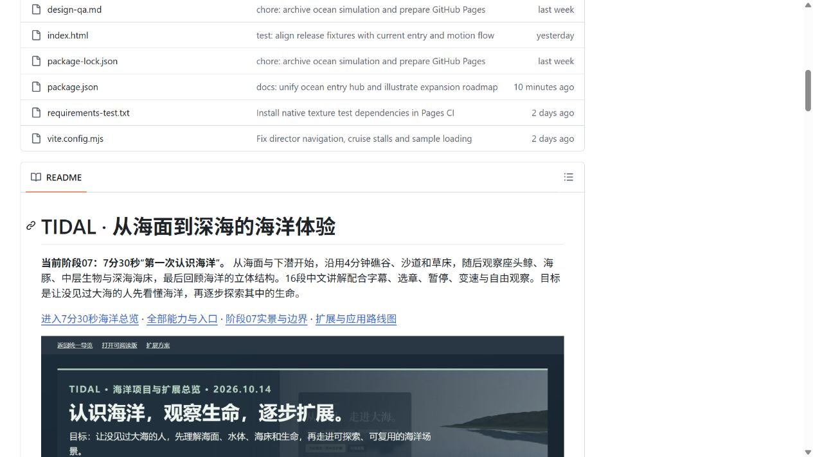
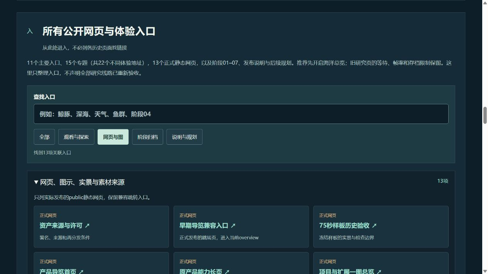
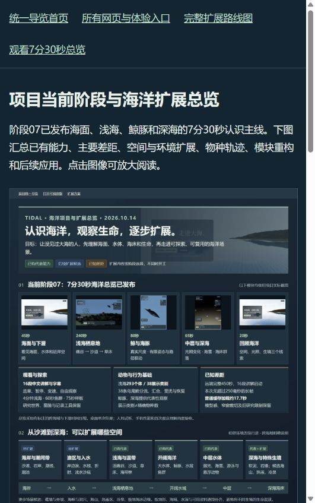
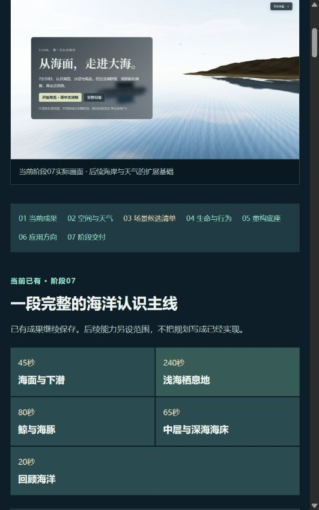

# 阶段07项目导览：线上检查原始归档

归档日期：2026-10-14。本目录原样保存此前已完成的线上检查JSON与4张截图，使新克隆仓库也能查看原始证据。

检查对象是发布提交 **f3bf094e11e4dea764b697ac50cefcecbada5663**，对应[成功的构建、8组世界检查和部署](https://github.com/yydshly/ocean-world/actions/runs/38526233529)及原标签 `stage-07-project-map-20261014`。本次补档没有重新测量加载或播放，也没有修改场景、资产、动物、讲解和存档。

## 文件与范围

- [原始线上检查JSON](remote-browser-checks.json)：README图像点击进入首页、首页进入总图、总图进入扩展页；13个正式HTML逐页打开、首页搜索与筛选、新图解码及18类场景清单。
- [完整性清单](manifest.json)：5个原文件的字节数与SHA256，保留原目录和受验版本。JSON的SHA256与原远端标签记录完全一致：`424971b02e62fcffb339adb6e6096eb135d4c2ffb1ac2f72c4be9d38ded15a12`。
- 原始JSON中的4个截图相对引用仍直接可用。不同截图来自当时不同窗口尺寸，不能作为固定视口的性能对比。

| 原始截图 | 内容 | 原图尺寸 |
| --- | --- | --- |
| [remote-readme.jpg](remote-readme.jpg) | README外层总图实际呈现 | 1265×712 |
| [remote-home.jpg](remote-home.jpg) | 新统一首页与正式网页筛选 | 1265×712 |
| [remote-map.jpg](remote-map.jpg) | 线上项目与扩展总图页面 | 531×847 |
| [remote-scenes.jpg](remote-scenes.jpg) | 扩展页的场景候选清单 | 531×847 |

这是导航与文档展示证据，不代表22个不同体验地址全部重新完整播放。原加载、真实感、研究模块等待、存档恢复和低帧率等限制保留。完整450秒运行仍引用[此前阶段07发布验收](../stage-07-publication-20261014.json)。

## 原始画面

## 阶段收口

本轮仅完成原始证据补档与远端提交。当前阶段到此归档；未来按具体需求选定新阶段，再确定有限范围和验收标准。
